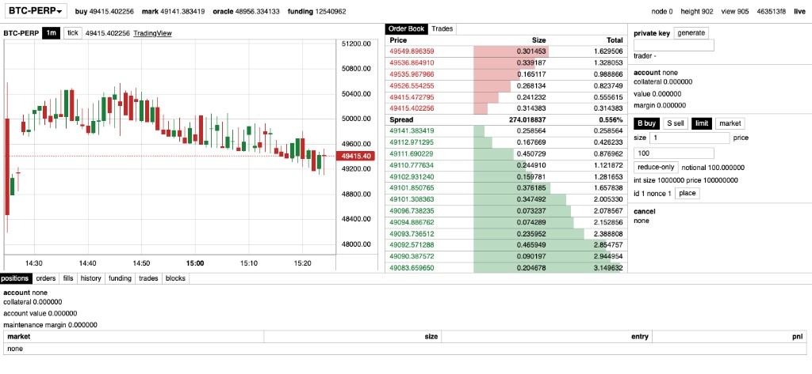

# tiny

A toy implementation of Hyperliquid (HyperCore) in Python. Each chain component is one file in `core/`: consensus, the API, the book, and the rest. The goal is no component over 1,000 lines, and all of `core/` under 3,333. It is 3,879 lines today, so there is still pruning to do. The playground is `sim/`. The trading UI is `ui/`.



Run commands from the repo root. Use `python -m`, not a file path. Running a file directly puts `core/` on the path, and `types.py` shadows the standard library.

## Install

```
uv sync
cd ui && npm install
```

## Run the sim

One process runs the validators, the bots, a fake price feed, and the API.

```
uv run python -m sim --validators 4
```

The API listens on http://127.0.0.1:8000. Node 0 writes its block log to `sim.sqlite` and replays it on the next start, so the UI keeps its history. `--db other.sqlite` picks a different file. `--db ""` runs with no database.

`--kill 3` stops that validator. `--bots` defaults to 100. `--api-port` defaults to 8000.

## Run the UI

Start the sim first, then in another terminal:

```
cd ui && npm run dev
```

Vite serves the UI and proxies `/trades`, `/candles`, `/ws`, and the other API routes to port 8000. Open the URL it prints.

To trade from a wallet, connect it and press `key from wallet`. The wallet signs a fixed message and its SHA-256 hash becomes your ed25519 trading key, so the same wallet always opens the same tiny account. Browser-extension wallets work as is. QR and mobile wallets need a WalletConnect project id in `VITE_WALLETCONNECT_PROJECT_ID`.

## Run the tests

```
uv run pytest
cd ui && npm test
```

Lint, format, and the 1,000-line limit:

```
uv run ruff check . && uv run ruff format --check . && uv run python scripts/check_loc.py
```

## Run a node with a database

`python -m core` is one validator over TCP. It reads `cluster.json` for every validator's host, port, and public key, and a hex ed25519 private key that matches `--id`. A cluster is one process per id, all sharing the same config. `--db` is that process's sqlite file: the block log plus the trade, order, and funding indexes. The sim is what serves the API the UI uses.

One validator, persisted to `tiny.sqlite`:

```
uv run python -m core --id 0 --config cluster.json --key-file key0.hex --db tiny.sqlite
```

Write a one-validator config from the repo root. `key0.hex` is a private key, so leave it untracked:

```
uv run python - <<'PY'
import json
import os
from pathlib import Path

from core.node import public_key

key = os.urandom(32)
Path("key0.hex").write_text(key.hex() + "\n")
Path("cluster.json").write_text(json.dumps({
    "markets": [{
        "name": "BTC-PERP",
        "tick_size": 1,
        "lot_size": 1,
        "max_leverage": 10,
        "maintenance_margin_bps": 300,
    }],
    "validators": [{
        "id": 0,
        "host": "127.0.0.1",
        "port": 9000,
        "public_key": public_key(key).hex(),
    }],
}, indent=2) + "\n")
PY
```

For more validators, add ids `1..n-1` to `validators`, write one `keyN.hex` per id, and start one process per `--id`.

## Core files

Line counts from `uv run python scripts/check_loc.py`. Recount after edits. Each file stays under 1,000 lines. The total should come down from 3,879 to under 3,333.

| Lines | File | What it is |
| ---: | --- | --- |
| 1 | `core/__init__.py` | Package marker |
| 154 | `core/__main__.py` | Process entry for one validator (`python -m core`) |
| 239 | `core/api.py` | REST and WebSocket API |
| 195 | `core/book.py` | Price-time priority order book |
| 189 | `core/bridge.py` | Bridge headers and relayer Merkle proofs |
| 501 | `core/consensus.py` | Chained HotStuff and the pacemaker |
| 318 | `core/net.py` | TCP transport |
| 644 | `core/node.py` | One validator: keys, mempool, consensus, state |
| 719 | `core/state.py` | Accounts, positions, oracle prices, funding, liquidations |
| 571 | `core/store.py` | Block log and indexes for trades, orders, and funding |
| 348 | `core/types.py` | Shared data types only |
| 3879 | total | Goal is under 3,333 |

`sim/` and `tests/` have no line limit.

Agent setup (skills, MCP) comes from [agent-boilerplate-v2](https://github.com/fatherjake/agent-boilerplate-v2); see `.agents/BOILERPLATE.md`.

## TODO

### Custom leverage

Today every order is margined at the market's `max_leverage`, and the UI shows it as fixed. To let a trader pick leverage per market, change initial margin only. Maintenance margin, liquidation and funding stay as they are, since they already work from account value against each market's `maintenance_margin_bps`.

- `core/types.py`: add `leverage: dict[str, int]` to `Account`. A missing market means `max_leverage`. Add a `SetLeverage(trader, market, leverage)` body to `TxBody`.
- `core/state.py`: add a `SetLeverage` case to `_apply_body`. `_set_leverage` ignores a wrong signer, an unknown market, or a value outside `1..max_leverage`. It reverts the change if the account no longer covers initial margin on its positions and resting orders.
- `core/state.py`: add `_lev(trader, market)`. Use it in `_initial`, and in a new `_initial_used(trader)` that holds the two loops now in `_can_margin`.
- `core/state.py`: read `leverage` in `from_bytes`. The field changes every state root, so an older `sim.sqlite` has to be deleted.
- Tests: an order margined at a lower leverage, a decrease that gets reverted, and an out-of-range value that does nothing.
- UI: encode `set_leverage` txs, bring back the leverage slider so it sends one, and read `account.leverage[market]` in the order form.
